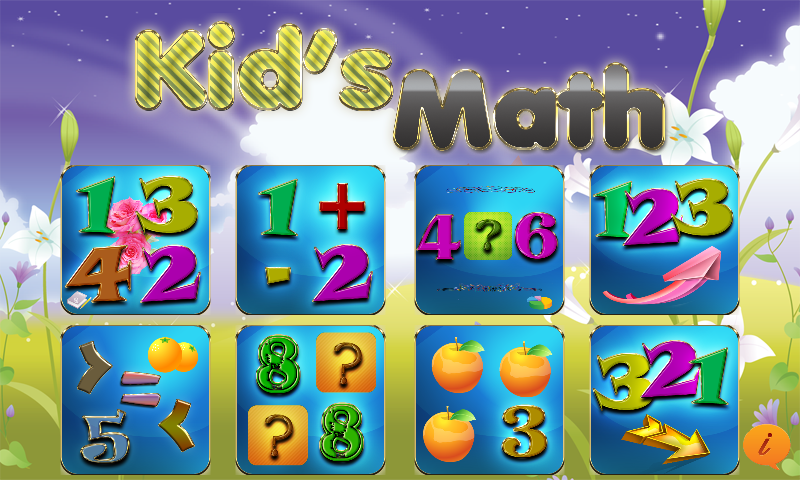

# Kids-Math

A Windows desktop math game for children, migrated from Windows Phone 8 to WPF.

## Screenshot



## Requirements

- Windows 10 or Windows 11.
- Visual Studio 2022 17.8+, with **.NET desktop development** and the **.NET 8 SDK / targeting pack** installed.
- To run a built executable, install the .NET 8 Desktop Runtime, or publish a self-contained build.

## Build and run

Open `Math4Kid.sln`, select `Math4Kid` as the startup project and press F5.

From a terminal:

```powershell
dotnet build Math4Kid.sln
dotnet run --project Math4Kid/Math4Kid.csproj
```
